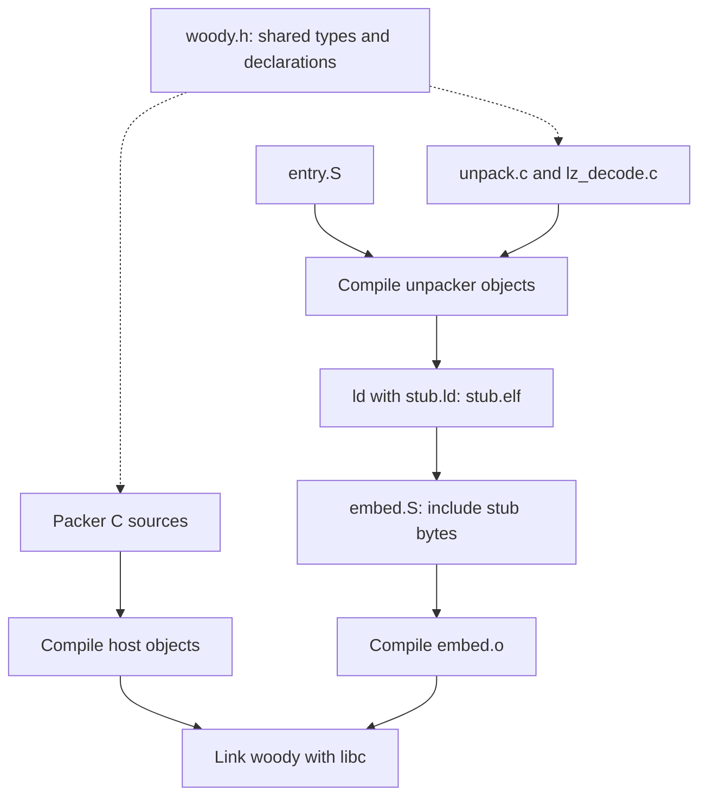
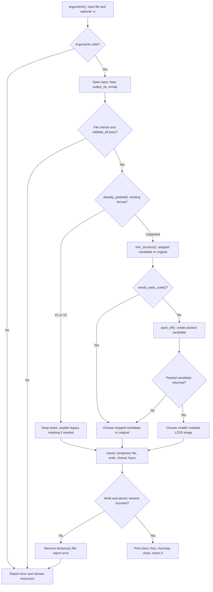
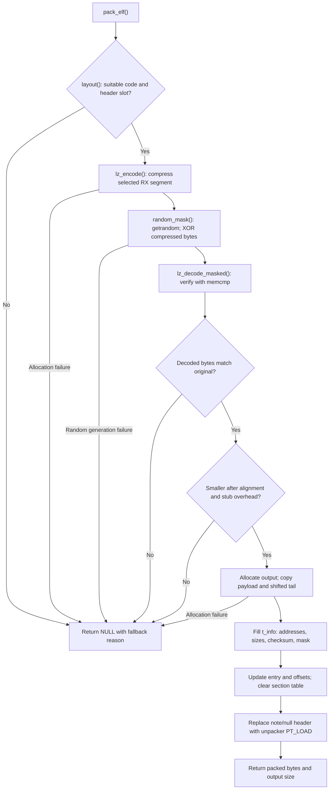
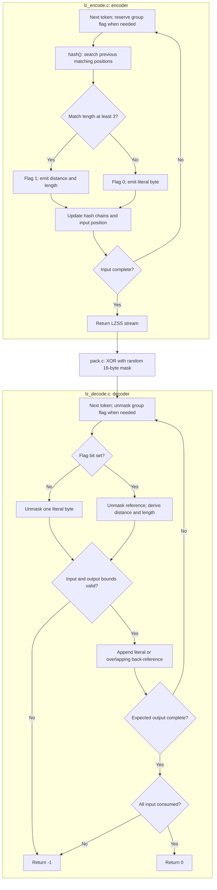
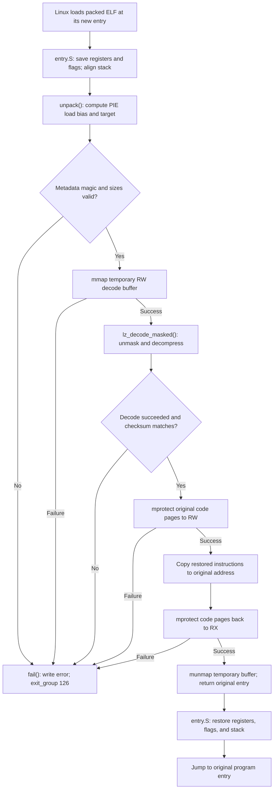

# Woody code diagrams

These diagrams describe the current C/ASM version with LZSS compression and
per-file XOR masking. Build-time work, packing, and packed-program startup are
separate phases. No external programs are invoked by the packer.

## 1. Build and embedding

The packer sources are `main.c`, `elf.c`, `pack.c`, `lz_encode.c`, and
`lz_decode.c`. The decoder is compiled once for the host and once for the
freestanding unpacker.

`stub.ld` places the 72-byte metadata block before `loader_entry`, followed by
code and constants. It rejects unpackers requiring writable global data.

## 2. Packing command and file handling

This is the main control flow in `main.c`, with the ELF helpers in `elf.c` and
packing helpers in `pack.c`.

Validation checks ELF64/x86-64 format, program-header bounds, segment sizes and
alignment, interpreter termination, and an executable entry point. Metadata
trimming requires the removed suffix to contain only non-loaded section data,
section headers, or zeros. Unknown appended nonzero data prevents trimming.

`needs_early_code()` checks dynamic preinit, text relocations, IFUNC resolvers,
and required dynamic metadata. Such inputs use the stripped/original candidate.
Already-packed V1 inputs are retained without adding masking; masking them
requires the original, unpacked ELF.

## 3. Packing internals

Every fallback below returns `NULL` to `process()`, which retains its base
candidate. Packing failures do not publish a partially packed file.

`layout()` chooses the largest suitable readable/executable, non-writable load
segment, checks page/file overlaps, and finds a replaceable note/null header
after the existing load headers. `note_slot()` preserves GNU property headers.
Offset reductions preserve the load segments' required alignment.

## 4. LZSS encoder and shared decoder

The encoder uses a 4 KiB window, a maximum match length of 18 bytes, and up to
128 hash-chain candidates. Each group has one flag byte and up to eight tokens.
A literal uses one byte; a back-reference uses two bytes for distance and length.

`lz_decode()` is the unmasked wrapper: it calls `lz_decode_masked()` with a null
mask. `byte()` applies the XOR mask when present. `checksum()` implements FNV-1a
over the original code; the runtime uses it to detect corrupted decoded bytes.

## 5. Startup of a newly packed executable

This runs when the output binary is executed, rather than when `woody` packs it.
The original register state and stack are restored before the final jump.

`call()` is the inline-assembly Linux syscall bridge. Runtime restoration uses
`mmap`, `mprotect`, and `munmap`; failure reporting uses `write` and `exit_group`.
The `munmap` return value is ignored in the current implementation. No second
process or unpacked temporary executable is created.

## Shared structures

`woody.h` provides declarations, constants, and these structures:

| Structure / field | Purpose |
| --- | --- |
| `t_info.magic` | Identify the packed format |
| `t_info.self` | Unpacker's link-time address, used to calculate load bias |
| `t_info.entry` | Original program entry address |
| `t_info.target` | Original code segment address |
| `t_info.raw_size` | Restored code length |
| `t_info.packed_size` | Masked compressed payload length |
| `t_info.checksum` | FNV-1a value of original code |
| `t_info.prot` | Restored code permissions, RX |
| `t_info.mask` | Per-file 16-byte XOR mask |
| `t_report.raw_size`, `compressed_size` | Progress counters |
| `t_report.reason` | Packing result or fallback explanation |

`t_info` occupies 72 bytes. The old unmasked format has a 56-byte common prefix.
Masking is reversible obfuscation: its recovery information ships in the ELF.
