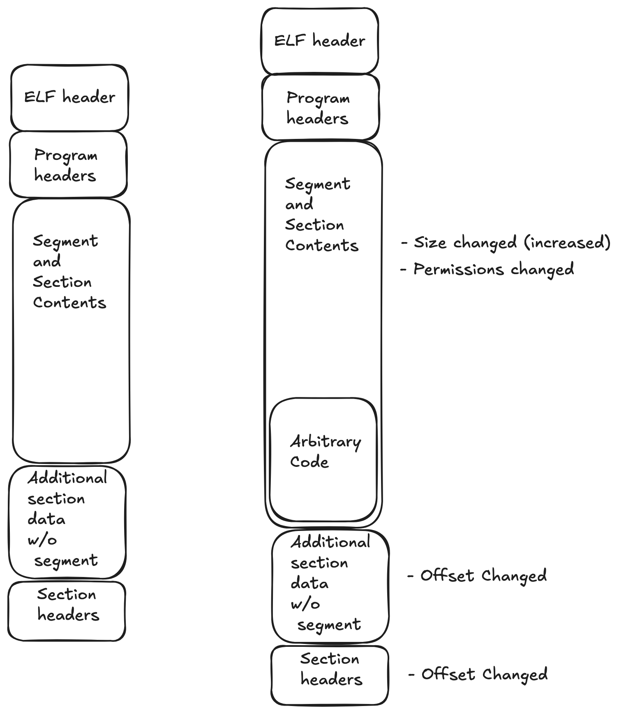

# Famine
A simple virus program that recursively infects the files in a given root directory by patching binary files; making them run a duplication routine that re-runs the virus logic before jumping back to the main program.

## Overview
This is built for fun, for a Ubuntu 37 machine with kernel 6.14.0. It currently does not do anything really maliclous, just does self replication on the systems binary only. Hence, it is unstable and there will be a risk of system failure when running this on root, such as when this process interferes with system processes who are using the binaries.

## Features
- Evasion routine
- Recursive Root file infection (unstable as system processes might use the programs mid-infection)
- Packer for static analysis prevention
- Launch infection routine as background process
- Multi infection prevention chech via signatures
- Re-infection on executing infected binaries

## Installation and usage
The following are required to build the program
- Cmake version 3.23
- NASM version 2

To build, create the build files
```
cmake -S . -B build <options>=ON/OFF
```

Current supported options are:
- DROOT_MODE - Root mode, which infects all binaries in the system in /usr/bin. Default OFF
- DISPLAY_INFECT - Enable infection logging. Default ON

And then run the build command
```
cmake --build build
```

Run the virus
```
./build/famine/Famine.packed # sudo is needed for build mode
```

## How it works
### Design
The virus will inject arbitrary code to already existing binaries by editing the binary directly. It will look for something called a 'codecave' which is a place in binary where arbitrary instructions can run during runtime (Imagine the null bytes space after the .text section of a ELF program. We can add things there without making the program un-runnable).

When a program runs, it will read the file, load the instructions and execute them. If we put custom instructions inside the file without overwriting the old functions, and find a way to run our custom instructions first then jump to the original intended instructions, we have essentially created a function hook.

```
Original function
       |
       v
Custom hook executes first
       |
       v
Original function executes
       |
       v
Original behavior continues
```

The virus itself, will be implemented as a function hook. At this point, it is already assumed one is familiar with how the ELF loader works, and what consists in an ELF file. If not, check out [Executable loading process here](https://github.com/neosizzle/woody-woodpacker) 

The location of the codecave to place the hook however, can vary. For this implementation, it selects the last PT_LOAD segment, places the code at the end of the segment, extending the segment size and resizing the file if needed to give more space to the segment.


> Before on the left, after on the right

Such a design has its own benefits where
- It has a higher infection rate
- No optimization needed for size of virus code since the size can be self defined.
- Since it is the last segment, it wont break virtual addressing of other segments when resizing.

Of course, it also has limitations whereby
- overlapping memory addressing when bss section is too high, which the infection will be skipped
- change in file size can be easily detected
- worse performance due to increase of buffer size 
- non atomic as in resizing and writing are two seperate actions. (ftruncate and mmap write)

### Virus flow
```
Check if rip - a few bytes have data 
(used to store old entry address offset, defautled to 0)
├── Yes, we are running from an infected file
├── Fork
│   ├── Parent will jump to original entry using entry address offset
│   └── Child will be doing evil stuff
│       ├── Run evasion routine (see below)
│       └── Run infection routine (see below)
└── No, we are patient zero
    ├── Run evasion routine
    │   ├── Iterate through and read /proc/<pid>/status for all pid
    │   │   └── If the process name is blacklisted, return 1
    │   └── If clear, return 0
    ├── If evasion routine tripped, exit immediately
    └── Run infection routine
        └── Iterate though all files from predefined root
            ├── If the current 'file' is a folder, recursively iterate its own files
            └── Infect single file
                ├── Minimum file size gate
                ├── ELF 64bit file type gate
                ├── Executable ELF check gate
                ├── Double infection prevention gate
                ├── Codecave plasability gate
                ├── Resize (expand) file
                ├── Padding pass (pad the empty size with 0)
                └── Patching pass (replace 0 with virus code)
```

### Codecave construction (patching pass)
```
patching pass
├── Locate segment with the furthest vaddr
├── Write params to ELF file
│   ├── Calculate offset to write
│   └── Calculate entry gap from _start (including param + signature gap)
├── Write shellcode to ELF file
│   └── Write all data in precomputed _start relative label to _end relative label from rip
├── Change segment permission to RWX
├── Change mem and file size of segment
├── Change section header offset
├── Change entry
├── Get file offset from segment and locate the section header pointing to this segment
└── Change offset of sections after the section found above
```

### Pitfalls and useful tools 
During development, I had a few instances where I faced some issues where I need a specific (almost arbitrary) solution to fix the issue. Such as the requirement of an arbitrary offset to read the data correctly. It turns out that was actually an earlier issue upstream when the data is being written originally. 

Such an issue only surface when more critical bugs do happen (a segfault on a normal operation). It is only through debugging the critial issue then only I found out the reason of the arbitrary patch on a smaller issue earlier. The lesson is, if it feels wrong, it probably is.

There are some tools I find useful when developing this; I will list them out here

**pwndbg / any gdb debugger**
This is obvious, it is a neccasity for debugging asm programs. I personally prefer pwndbg because it supports context support
[pwndbg](https://pwndbg.re/stable/features/])

**setup.sh**
This is a simple script to set up the /tmp/test folders, it has multiple basic test cases and it is a convineent script to set up the environment for testing.

**check_pl_sz.sh**
This is a simple script that measures the size of a .text section of an ELF program, useful for space optimization.


## Research pipeline
- gdaryl mission

